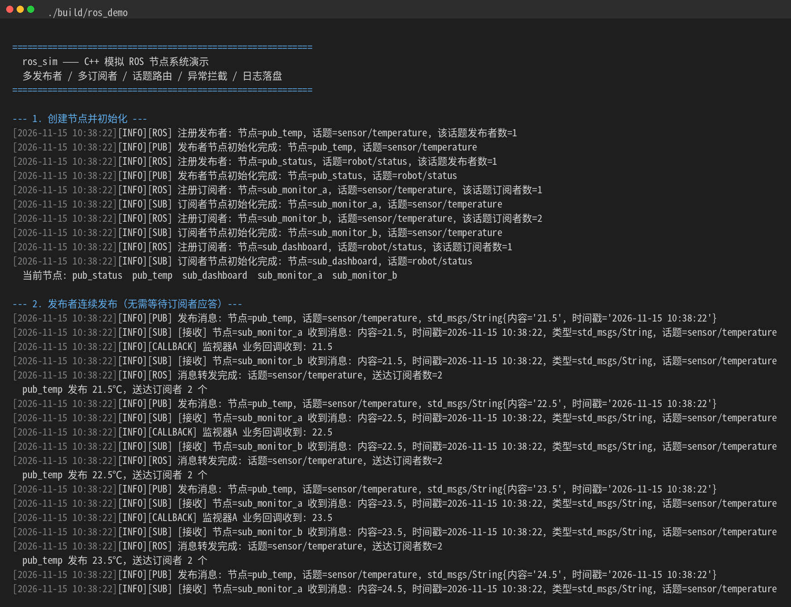
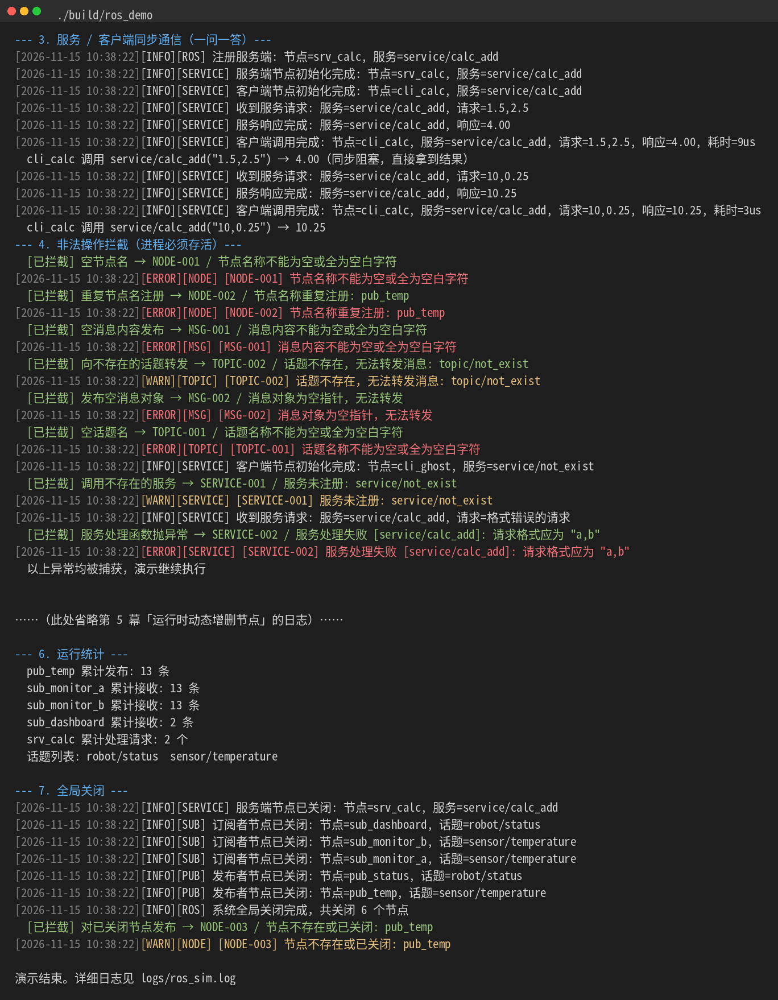

# ros_sim —— C++ 模拟 ROS 节点系统

> 课程大作业：不依赖真实 ROS API，用 C++17 复刻 ROS 最核心的"节点—话题"发布/订阅通信模型。
> 覆盖节点抽象、消息封装、单例核心路由、异常体系与分级日志，并实现传感器自定义消息、服务/客户端同步通信、运行时动态增删节点等加分功能。

## 快速开始

```bash
cmake -S . -B build -DCMAKE_BUILD_TYPE=Release
cmake --build build -j
./build/ros_demo        # 完整演示（7 幕）
cd build && ./ros_tests # 结构化测试（48 用例 / 114 断言）
```

或直接使用脚本：`./scripts/build_and_run.sh`、`./scripts/run_tests.sh`。

## 运行效果





完整原始输出见 `docs/运行效果示例.txt`（192 行，由 `./build/ros_demo` 实际运行捕获）。

### 运行可视化报告

`ros_demo` 结束时会额外生成一个自包含的 `report.html`（同目录，无需网络与第三方库）：
页面上是本次运行的日志事件流（可按 INFO/WARN/ERROR/**传感器** 四类筛选、按节点名/话题/错误码搜索）、
传感器数据面板（最新温湿度、温度/湿度趋势曲线、逐个采样点表格）、话题与服务拓扑、
模块事件分布，以及异常拦截清单。页面上还有三个下载按钮：事件流可按当前分类（如"传感器"）
导出 `.txt` 日志，传感器面板导出温湿度日志，异常清单导出异常日志；导出文件带 UTF-8 BOM，
双击用记事本打开不乱码。每次运行都会覆盖重写，数据完全来自
`Logger` 的内存捕获，不含任何编造数据。

```bash
./build/ros_demo              # 结束时会打印 report.html 的绝对路径
# Windows 下会自动用默认浏览器打开；其他平台手动打开即可
```

在 CLion 里运行时，报告会生成在构建目录（`cmake-build-debug/report.html`），
因为 IDE 把工作目录设成了构建目录。

## 验证结果

| 项 | 结果 |
| --- | --- |
| 编译 | g++ 11.4 + CMake，`-Wall -Wextra -Wpedantic` **零警告** |
| 测试 | **48 个用例 / 114 个断言全部通过** |
| 内存检查 | ASan + UBSan 下测试与演示**零报告** |
| 性能 | 1 万条发布：1 订阅者 15.3 ms、3 订阅者 24.0 ms |

## 工程结构

```
ros_sim/
├── CMakeLists.txt          # 静态库 rossim + ros_demo + ros_tests
├── include/ros/            # 公开头文件（聚合头 ros_sim.h）
│   ├── exception.h         # 异常体系与错误码（NODE/TOPIC/MSG/SERVICE/ROS）
│   ├── logger.h            # 分级日志，控制台 + 文件
│   ├── message.h           # Message / SensorMessage
│   ├── node.h              # 节点抽象基类
│   ├── publisher.h / subscriber.h
│   ├── ros.h               # 单例核心：映射、路由、关闭、动态删除
│   ├── service.h           # 同步请求-响应
│   ├── report.h            # 运行可视化报告（日志 → HTML）
│   ├── timestamp.h / util.h
│   └── ros_sim.h
├── src/                    # 实现 + main.cpp（演示）
├── tests/                  # 轻量测试框架 + 4 组用例
├── docs/                   # 01~06 文档
└── scripts/                # 一键构建/测试脚本
```

## 在 IDE 中使用

### VS Code（推荐，作业说明中的首选）

1. 装两个扩展：`C/C++`（ms-vscode.cpptools）、`CMake Tools`（ms-vscode.cmake-tools），打开文件夹时 VS Code 也会按 `.vscode/extensions.json` 提示安装；
2. `文件 → 打开文件夹` 选择 `ros_sim` 根目录（**不要**只打开单个 `.cpp`，否则 CMake 与头文件路径都不生效）；
3. 底部状态栏选择预设 `release`（日常）或 `debug`（调试），首次会自动配置；
4. 底部状态栏把 **Launch target** 设为 `ros_demo`，按 `F5` 即可断点调试；改成 `ros_tests` 再按 `F5` 就能单步看测试；
5. 快捷键：`Ctrl+Shift+B` 构建，`Ctrl+Shift+P → Tasks: Run Task → 运行全部测试 (ctest)` 跑测试。

仓库已内置 `.vscode/tasks.json`、`launch.json`、`c_cpp_properties.json`、`settings.json` 与 `CMakePresets.json`（release / debug / asan 三套预设），无需手动填配置。

### Visual Studio 2022

1. `文件 → 打开 → 文件夹`，选择 `ros_sim` 根目录（VS 原生支持 CMake，会自动读取 `CMakeLists.txt`）；
2. 等待输出窗口出现 `CMake 配置完成`；若不是，右键 `CMakeLists.txt → 为此文件夹生成缓存`；
3. 顶部工具栏的启动项下拉框选择 `ros_demo.exe`（或 `ros_tests.exe`），按 `F5` 调试、`Ctrl+F5` 直接运行；
4. 想切换 Release/Debug：顶部配置下拉框选 `x64-Debug` 或 `x64-Release`。

### CLion

1. `File → Open` 选择 `ros_sim` **文件夹**（或直接选 `CMakeLists.txt`），CLion 会以 CMake 工程导入并自动配置；右下角提示 `CMake project loaded successfully` 即成功；
2. 右上角运行配置下拉框里会自动出现 `ros_demo` 和 `ros_tests` 两个目标，选 `ros_demo` 点绿色三角（`Shift+F10`）运行，选 `ros_tests` 运行测试；
3. 断点调试：选 `ros_demo` 点虫子图标（`Shift+F9`）；
4. 工具链要求：`Settings → Build, Execution, Deployment → Toolchains` 里要有一个可用的 C++ 工具链——Linux 用系统 GCC、macOS 用 Xcode CLT、Windows 用 MinGW-w64 或 Visual Studio（**不要**旧的 Cygwin）；
5. 若 CLion 版本低于 2022.3，不会读取 `CMakePresets.json`，会用自己的 `cmake-build-debug` 配置，同样能编译运行，不影响；
6. 工作目录：CLion 默认在构建目录下运行，日志会写到 `cmake-build-debug/logs/`。想让它落在工程根目录，在 `Run → Edit Configurations` 里把 `Working directory` 改成 `$ProjectFileDir$`。

> Windows 上的两点提醒：本工程只用了标准库，但 `std::filesystem` 在 MinGW 里需要 gcc 8 以上；CMakeLists 已按编译器分支设置警告选项（MSVC 用 `/W4 /utf-8`，GCC/Clang 用 `-Wall -Wextra -Wpedantic`），因此 MSVC 工具链也能零警告编译。

### 常见问题

| 现象 | 原因与处理 |
| --- | --- |
| 头文件 `ros/ros_sim.h` 报红 | 未以文件夹方式打开，或没配置成功；`C/C++` 扩展会通过 `CMake Tools` 自动取 `include/`，重新配置一次即可 |
| 提示找不到 `msvc` 生成器 / 无法选择工具链 | Windows 装 “使用 C++ 的桌面开发” 工作负载；或改用 VS Code + MinGW（`CMakePresets.json` 不锁定生成器，会自动适配） |
| 终端中文乱码 | 程序启动时已调用 `SetConsoleOutputCP(CP_UTF8)` 把 Windows 控制台切到 UTF-8，源码与日志都是 UTF-8，正常情况下不会再乱。若 IDE 仍显示乱码，是 IDE 自己的解码问题：CLion 在 `Help → Edit Custom VM Options` 加一行 `-Dfile.encoding=UTF-8` 后重启；旧版控制台可手动 `chcp 65001` |
| ERROR 日志跑到最前面、与正常输出错位 | 已修复：日志写 stderr 前先 flush stdout、写完立即 flush。若用旧版本代码仍出现，是把 stdout/stderr 重定向到同一文件再合并显示造成的，属预期 |
| 运行后看不到 `logs/ros_sim.log` | 工作目录不对。VS Code 的 `launch.json` 已设 `cwd=${workspaceFolder}`；VS 下请把调试工作目录设为工程根目录 |
| 单文件编译报链接错误 | 本项目是 CMake 多文件工程，必须整体构建，不能只 `g++ main.cpp` |

## 核心设计要点

1. **`Node` 抽象 + 纯虚 `init/shutdown`**：核心只依赖抽象，`shutdownAll()` 统一关闭所有节点。
2. **`Message` 不可变**：构造即打时间戳，只有 const getter；转运用 `shared_ptr<const Message>`，O(1) 共享且防篡改。
3. **单例核心（Meyers Singleton）**：函数内静态变量，线程安全、延迟初始化、无初始化顺序问题。
4. **锁只保护映射表，回调一律锁外执行**：先拷订阅者副本再分发，避免持锁回调导致的死锁与迭代器失效。
5. **异常三要素（模块 / 错误码 / 级别）**：继承 `std::runtime_error`，兼容标准捕获，同时可分级记日志、可按错误码断言。
6. **零依赖**：不引入 gtest/boost，测试框架自研，评审机器上开箱即跑。

## 文档

| 文档 | 说明 |
| --- | --- |
| `docs/01-需求文档.md` | 范围、术语、功能/非功能需求（FR/NFR 编号）、验收标准、追踪矩阵 |
| `docs/02-架构设计文档.md` | 四层架构、类设计、时序图、7 个关键设计决策、接口契约 |
| `docs/03-技术文档.md` | 代码组织、7 个关键技术点、错误码总表、实测数据、已知限制 |
| `docs/04-用户手册.md` | 构建运行、5 分钟写第一个节点、API 速查、错误码速查、10 条 FAQ |
| `docs/05-测试用例文档.md` | 用例设计方法、48 条用例表、执行结果、覆盖率、缺陷记录 |
| `docs/06-答辩准备.md` | 3 分钟讲解稿、5 看点演示脚本、15 条高频问答 |

## 增量开发轨迹

```bash
git log --oneline
```

按"文档 → 骨架 → 异常/日志 → 消息 → 节点/核心 → 自定义消息 → 服务 → 动态节点 → 测试 → 文档"的顺序提交，每次提交均可独立编译运行。
