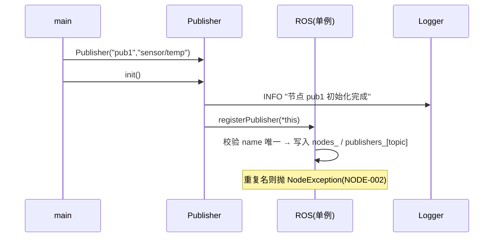
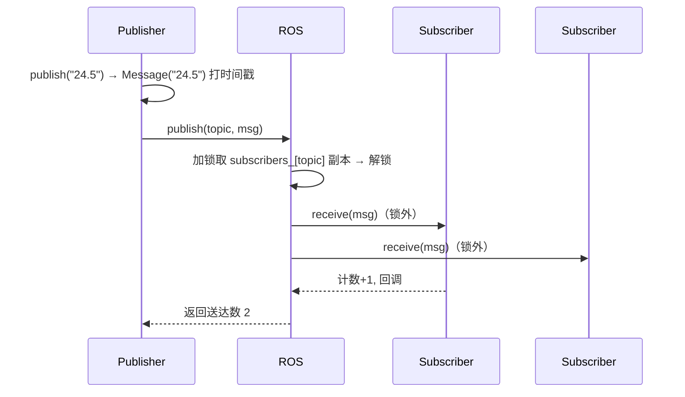
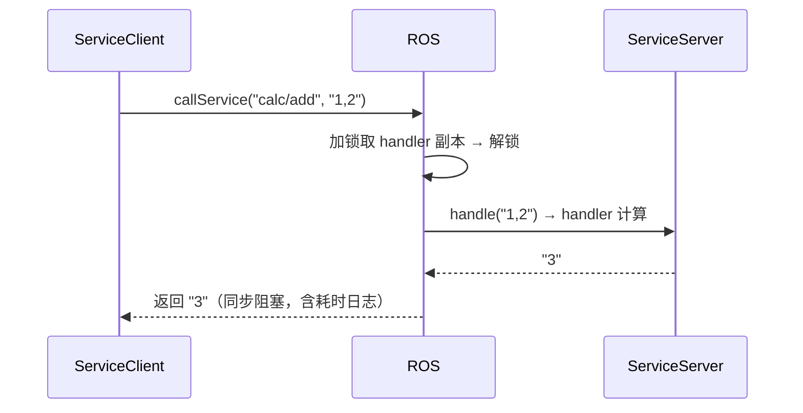

# 架构设计文档：ros_sim

| 项目 | 内容 |
| --- | --- |
| 文档版本 | v1.0 |
| 编写日期 | 2026-11-14 |
| 上游输入 | 《01-需求文档》v1.0 |
| 目标 | 说明 ros_sim 的分层、模块职责、类设计与关键设计决策，作为编码与评审依据 |

## 修订记录

| 版本 | 日期 | 说明 |
| --- | --- | --- |
| v0.1 | 2026-11-11 | 初稿：分层与类草图 |
| v0.2 | 2026-11-13 | 补充时序图、锁策略、所有权约定 |
| v1.0 | 2026-11-14 | 与实现对齐，冻结接口 |

---

## 1. 设计目标与原则

| 原则 | 落地方式 |
| --- | --- |
| 单一职责 | 一个类只做一件事：`Message` 只管数据，`Logger` 只管输出，`ROS` 只管路由 |
| 开闭原则 | 新增消息类型/节点类型通过继承扩展，不修改核心转发逻辑 |
| 依赖倒置 | 核心通过 `Node` 抽象接口关闭节点，不关心具体是发布者还是订阅者 |
| RAII | 文件流、互斥量用 RAII 封装（`std::ofstream`、`std::lock_guard`），无手工 `close`/`unlock` |
| 异常安全 | 非法输入一律抛自定义异常；`init`/`publish` 失败不留半注册状态 |
| 最小锁范围 | 锁只保护注册表读写，**回调一律在锁外执行**，避免"持锁回调 → 回调再发布 → 死锁" |
| 可测试 | 核心提供 `reset()`；节点可在栈上构造；无全局静态状态污染 |

## 2. 总体架构（四层）

```
┌──────────────────────────────────────────────────────────────┐
│ 表现层 / 应用层                                                │
│  src/main.cpp（演示程序）        tests/*（自动化测试）          │
│  职责：组装节点、发起调用、顶层 try/catch 兜底                   │
└───────────────────────────┬──────────────────────────────────┘
                            │ 只依赖抽象接口
┌───────────────────────────▼──────────────────────────────────┐
│ 业务层：节点抽象                                              │
│  Node（抽象基类）── Publisher / Subscriber / ServiceServer /    │
│                    ServiceClient                              │
│  职责：节点生命周期（init/shutdown）、业务语义（publish/         │
│        receive/call）                                        │
└───────────────────────────┬──────────────────────────────────┘
                            │ register / unregister / forward
┌───────────────────────────▼──────────────────────────────────┐
│ 核心层：ROS 单例                                              │
│  话题→发布者 map、话题→订阅者 map、服务名→服务端 map、          │
│  节点名→节点 map                                             │
│  职责：注册、注销、路由转发、全局关闭、查询                     │
└───────────────────────────┬──────────────────────────────────┘
                            │ Message / 异常 / 日志
┌───────────────────────────▼──────────────────────────────────┐
│ 基础设施层                                                  │
│  Message / SensorMessage（数据载体）                          │
│  RosException 体系（错误语义）                                │
│  Logger（分级日志，控制台 + 文件）                             │
└──────────────────────────────────────────────────────────────┘
```

依赖方向严格单向向下：`main → Node 子类 → ROS → Message/Exception/Logger`。核心层**不反向依赖**任何具体节点类型（`Node` 是抽象基类，核心只调用 `init/shutdown`）。

## 3. 模块划分

| 模块 | 文件 | 职责 | 对外接口 |
| --- | --- | --- | --- |
| 节点抽象 | `include/ros/node.h`、`src/node.cpp` | 节点命名、生命周期约定、名称唯一性前置校验 | `Node(name)`、`name()`、`init()`、`shutdown()`、`isRunning()` |
| 发布者 | `publisher.h/.cpp` | 话题属性、创建消息、发布日志、转发 | `publish(string)`、`publish(Message)`、`topic()` |
| 订阅者 | `subscriber.h/.cpp` | 话题属性、接收日志、用户回调 | `receive(msg)`、`setCallback()`、`receivedCount()` |
| 消息 | `message.h/.cpp` | 内容 + 时间戳封装，只读；传感器消息子类 | `content()`、`timestamp()`、`typeName()`、`toString()` |
| 核心 | `ros.h/.cpp` | 单例、三类映射、转发、全局关闭、动态删除 | `instance()`、`registerX`、`publish`、`shutdownAll`、`removeNode` |
| 服务 | `service.h/.cpp` | 同步请求-响应 | `ServiceClient::call()`、`ServiceServer::handle()` |
| 异常 | `exception.h/.cpp` | 错误码、等级、模块分类、日志字符串 | `code()`、`level()`、`toLogString()`、静态工厂 |
| 日志 | `logger.h/.cpp` | 级别过滤、控制台与文件双输出、线程安全 | `instance()`、`setLevel()`、`addFileSink()`、`info/warn/error` |

## 4. 类设计

### 4.1 `Message` 与 `SensorMessage`

| 成员 | 类型 | 说明 |
| --- | --- | --- |
| `content_` | `std::string` | 业务内容，构造后不可变 |
| `timestamp_` | `std::string` | `YYYY-MM-DD HH:MM:SS`，构造时由 `nowTimestamp()` 生成 |
| `content()` / `timestamp()` | `const std::string&` | 只读，无 setter |
| `typeName()` | `virtual` | 基类 `std_msgs/String`，子类覆盖为 `sensor_msgs/SensorData` |
| `toString()` | `virtual` | 供日志与序列化统一输出 |

`SensorMessage : Message` 额外持有 `temperature_`、`humidity_`，覆盖 `typeName()`/`toString()`，用于演示"自定义消息类型"的可扩展性（基类指针即可承载子类，转发层无需感知）。

### 4.2 `Node`（抽象基类）

| 成员 | 说明 |
| --- | --- |
| `name_` | `const std::string`，构造时校验非空（`NODE-001`），只读 |
| `running_` | `bool`，`init` 置 true、`shutdown` 置 false，用于幂等判断 |
| `init()` / `shutdown()` | `= 0` 纯虚，子类必须实现"日志 + 注册/注销" |
| `~Node()` | 虚析构，兜底注销，防止忘记 shutdown 造成的悬空指针 |

设计要点：基类**不做注册**，注册属于业务语义（发布者注册到 publisher 映射、服务端注册到 service 映射），因此交给子类在 `init()` 中完成；基类只保证"名称唯一 + 生命周期状态"这一共同契约。

### 4.3 `Publisher`

| 方法 | 签名 | 语义 |
| --- | --- | --- |
| 构造 | `Publisher(std::string name, std::string topic)` | 校验空话题 → `TOPIC-001` |
| `init` | `void init() override` | 日志 → `ROS::registerPublisher(*this)` → `running_=true` |
| `publish` | `size_t publish(const std::string& sensorData)` | 校验非空 → 创建 `Message` → 日志 → `ROS::publish` 转发，返回送达订阅者数 |
| `publish` | `size_t publish(const Message& msg)` | 复用已有消息（如 `SensorMessage`） |
| `shutdown` | `void shutdown() override` | 幂等；日志 → 注销 |

### 4.4 `Subscriber`

| 方法 | 签名 | 语义 |
| --- | --- | --- |
| 构造 | `Subscriber(name, topic, Callback cb = nullptr)` | 校验空话题 |
| `receive` | `void receive(const std::shared_ptr<const Message>& msg)` | 输出"内容 + 时间戳"日志 → 计数 +1 → 调用用户回调（异常在此捕获，避免影响发布者与其他订阅者） |
| `setCallback` | `void setCallback(Callback)` | 运行期替换业务回调 |

`Callback` 定义：`std::function<void(const Subscriber&, const std::shared_ptr<const Message>&)>`。用 `shared_ptr<const Message>` 而非裸引用，保证"一条消息多订阅者共享、只读、生命周期安全"。

### 4.5 `ROS`（单例核心）

| 成员 | 类型 | 说明 |
| --- | --- | --- |
| `nodes_` | `unordered_map<string, Node*>` | 节点名唯一性守卫 |
| `publishers_` | `unordered_map<string, vector<Publisher*>>` | 话题 → 发布者（一对多） |
| `subscribers_` | `unordered_map<string, vector<Subscriber*>>` | 话题 → 订阅者（一对多） |
| `services_` | `unordered_map<string, ServiceServer*>` | 服务名 → 服务端 |
| `mutex_` | `std::recursive_mutex` | 保护以上四张表；递归锁用于允许"持锁时触发一次同线程重入"（见 §6.4） |
| `shutdown_` | `bool` | 全局关闭标志，关闭后拒绝新注册 |

关键方法：

| 方法 | 复杂度 | 异常 |
| --- | --- | --- |
| `registerPublisher(Publisher&)` | O(1) 均摊 | `NODE-002` 重复名 |
| `publish(topic, shared_ptr<const Message>)` | O(k)，k=订阅者数 | `TOPIC-001/002`、`MSG-002` |
| `shutdownAll()` | O(n)，n=节点数 | 无（幂等） |
| `removeNode(name)` | O(n)（删 vector 元素） | `NODE-003` |
| `reset()` | O(n) | 无（仅供测试） |

### 4.6 `Logger` 与异常体系

- `Logger` 为单例：`level_`（默认 INFO）、`console_`（默认开）、`std::ofstream file_`；`log()` 持锁写两路，行格式
  `[YYYY-MM-DD HH:MM:SS][LEVEL][MODULE] message`。
- 文件打开失败**不抛异常中断业务**，而是 WARN 降级为控制台输出（FR-08.10）。
- 异常三要素：`module`（NODE/TOPIC/MSG/SERVICE）、`code`（`NODE-001`…）、`level`（INFO/WARN/ERROR）。`RosException` 继承 `std::runtime_error`，因此兼容标准异常捕获链，`catch (const std::exception&)` 也能兜住。

## 5. 关键流程

### 5.1 初始化与注册



### 5.2 发布与转发（核心链路）



要点：**先取副本再解锁再回调**。若持锁回调，订阅者回调中再次 `publish` 会因重入同一张表而死锁或降低并发度。

### 5.3 全局关闭

```
shutdownAll():
  加锁：拷贝全部节点指针到 vector，置 shutdown_ = true，解锁
  for node in 拷贝:  node->shutdown()   // 内部会 unregister，需要再取锁
  日志：系统已关闭，共 n 个节点
```
关闭时**不能持锁遍历并调用**（`shutdown` 内部要改表）。

### 5.4 服务同步调用（加分项）



## 6. 关键设计决策

### 6.1 单例实现：Meyers Singleton + 禁止拷贝

```cpp
static ROS& instance() { static ROS core; return core; }   // C++11 起线程安全的局部静态初始化
ROS(const ROS&) = delete; ROS& operator=(const ROS&) = delete;
```
放弃"饿汉式全局对象"：局部静态保证首次调用时才构造，且跨编译单元的初始化顺序问题被规避。
但 `ROS` 的析构发生在 main 之后，若节点是栈对象会先析构，故 `Node` 析构中注销采用 `try/catch` 兜底并判断 `instance` 是否已可用。

### 6.2 所有权：核心不拥有节点

- 节点对象由调用方持有（`main` 用 `std::unique_ptr`，测试用栈对象）；
- 核心只存**非拥有指针**，并在节点析构时由 `~Node()` 自动注销，避免悬空；
- 理由：若核心用 `unique_ptr` 拥有节点，则节点的 `init/shutdown` 时机与业务耦合，且"动态删除节点"会变成删除调用方仍在使用的对象，风险更高。约定写入用户手册（"节点生命周期由创建者负责"）。

### 6.3 用 `shared_ptr<const Message>` 传递消息

- 一条消息可能被 k 个订阅者共享，拷贝成本 O(k)；`shared_ptr` 只传递指针；
- `const` 修饰保证订阅者不能篡改（多订阅者下数据竞争的最小防护）；
- 生命周期由引用计数管理，回调可安全保存消息副本。

### 6.4 锁策略：`recursive_mutex` + 锁外回调

- 采用递归锁的原因：`registerPublisher` 与 `registerNode` 是嵌套调用关系（前者内部调后者），用普通 `mutex` 需拆成两把锁或手工保证不重入，易错；
- 但**回调/转发仍在锁外执行**——递归锁只解决"同线程重入不死锁"，不解决"持锁做业务"的性能与死锁风险；
- 计数用 `std::atomic<size_t>`，避免为统计再加锁。

### 6.5 异常而非返回码

- 非法输入是"程序员的错误"，不是"可预期的业务分支"，用异常强制调用方处理，避免返回值被忽略；
- 异常携带 `code`，便于日志检索与测试断言（`CHECK_THROWS_CODE`）；
- 分级：参数非法 → ERROR（配置/代码问题，需修）；资源/状态类（话题无订阅者、服务未注册）→ WARN（可降级运行）。

### 6.6 日志与业务解耦

- 业务代码只调 `Logger::instance().info(...)`，不关心去向（控制台/文件/未来网络）；
- 日志格式统一，便于 `grep ERROR` 做故障定位；
- 关闭时 `Logger::closeFileSink()` 显式 flush，保证最后几条日志落盘。

## 7. 目录结构

```
ros_sim/
├── CMakeLists.txt          # 构建：静态库 rossim + 可执行 ros_demo / ros_tests
├── README.md               # 一页纸说明 + 快速开始
├── .gitignore
├── include/ros/
│   ├── exception.h         # 异常体系与错误码
│   ├── logger.h            # 分级日志
│   ├── message.h           # Message / SensorMessage
│   ├── node.h              # 节点抽象基类
│   ├── publisher.h
│   ├── subscriber.h
│   ├── ros.h               # 核心单例
│   ├── service.h           # 服务端 / 客户端
│   └── ros_sim.h           # 聚合头文件（一行引入全部）
├── src/                    # 与 include 一一对应的实现 + main.cpp
├── tests/                  # 自研轻量测试框架 + 分模块用例
├── docs/                   # 01~06 文档
└── scripts/run_demo.sh     # 一键构建并运行演示
```

## 8. 接口契约（节选）

| 接口 | 前置条件 | 后置条件 | 异常 |
| --- | --- | --- | --- |
| `Node(name)` | `name` 去空白后非空 | 对象可构造，`running_=false` | `NodeException(NODE-001)` |
| `Publisher::init()` | 未调用过 init；核心未关闭 | 已注册，`isRunning()==true` | `NodeException(NODE-002)` |
| `Publisher::publish(s)` | 已 init；`s` 非空 | 消息送达该话题全部订阅者，返回送达数 | `MessageException(MSG-001)`、`TopicException(TOPIC-002)` |
| `Subscriber::receive(m)` | `m != nullptr` | 日志已输出，计数 +1 | 内部吞掉回调异常并记 WARN |
| `ROS::publish(t, m)` | `t` 非空、`m` 非空、话题存在 | 广播完成 | `TOPIC-001/002`、`MSG-002` |
| `ROS::removeNode(n)` | 节点已注册 | 节点已 shutdown 并从三张表移除 | `NodeException(NODE-003)` |
| `ServiceClient::call(req)` | 客户端已 init；服务已注册 | 同步返回响应 | `ServiceException(SERVICE-001/002)` |

## 9. 扩展点（v2 预留）

| 扩展 | 落点 | 改动量 |
| --- | --- | --- |
| 新消息类型（如 `LaserScan`） | 继承 `Message`，覆盖 `typeName()/toString()` | 单文件，零核心改动 |
| 消息队列 + 独立分发线程 | `ROS::publish` 改为入队，新增 `Dispatcher` | 中 |
| QoS（队列深度、丢弃策略） | `Subscriber` 增 `queueSize`，`ROS` 分发时判断 | 中 |
| 跨进程通信 | 抽象 `Transport` 接口，替换 `ROS::publish` 的本地调用 | 大（超出课程范围） |
| 序列化/落盘回放 | `Message::serialize()/deserialize()` + `rosbag` 类 | 小 |

## 10. 风险与限制

| 风险 | 影响 | 缓解 |
| --- | --- | --- |
| 回调在发布线程内执行 | 回调阻塞会拖慢发布 | 文档明确"回调应轻量"；v2 引入队列 |
| 裸指针非拥有 | 节点先于核心析构可能悬空 | `~Node` 兜底注销 + 关闭后拒注册 + 文档约定 |
| 单进程内存模型 | 无法跨主机 | 明确范围外，预留 `Transport` 扩展点 |
| 时间戳精度到秒 | 高频消息时间戳相同 | 文档说明；v2 可加毫秒 |
| 递归锁 | 重入保护掩盖调用环 | 代码评审约束"持锁只做表操作" |
